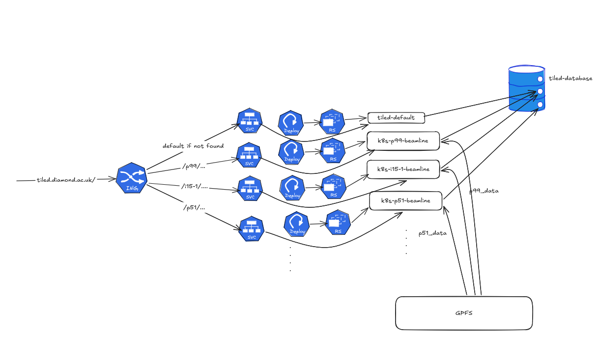

# Architecture

Tiled at Diamond runs as one Kubernetes Deployment **per beamline**, all sharing
a single database. Each beamline's pod can read only that beamline's data on
disk.



## Why one deployment per beamline

Reading a detector file is a filesystem operation, so it runs as whichever POSIX
user the pod runs as. Ideally that would be the user making the request, and the
POSIX UID is available from the access token when the request includes the
`posix-uid` scope. But a pod's POSIX user is fixed when the pod starts, so
acting as each user would need a separate pod per user, which is excessive for a
REST API.

Instead, there is a persistent deployment for each beamline:

- It runs as the POSIX user `k8s-ixx-beamline`.
- It has read-only access to `/dls/ixx/data` through the `ixx_data` ACL.

**The benefit is defence in depth.** If the authorization layer ever failed to
enforce access correctly, a request would still be limited by the filesystem
ACLs of the pod it reached. A request routed to `p99` can't read `p51`'s files,
whatever the access policy decides.

**The cost is complexity.** There are many deployments to run and upgrade, and
routing has to keep requests and data on the matching beamline.

## Request routing

A request is routed on the **beamline, the first segment of the Tiled path**:

```
https://tiled.diamond.ac.uk/api/v1/metadata/p99/cm12345/cm12345-1/...
                                            │
                                            ▼
                               k8s-p99-beamline
```

The diagram shows this as the ingress routing directly. In the chart there is an
extra hop, because cluster policy (Kyverno) forbids regex paths on Ingress
resources:

```
Ingress (a single "/" path) → Envoy → the beamline's Service → the beamline's pod
```

Envoy forwards the request unmodified. It only matches the Tiled endpoints that
address a node by path, listed in `envoy.pathPrefixes` in
[`values.yaml`](../Charts/tiled/values.yaml):

| Endpoints                                                                                     |
| --------------------------------------------------------------------------------------------- |
| `api/v1/search`, `distinct`, `metadata`, `register`, `data_source`, `revisions`               |
| `api/v1/array`, `ragged` (`block` and `full`)                                                 |
| `api/v1/table/partition`, `table/full`, `container/full`, `node/full`                         |
| `api/v1/awkward/...`, `asset/bytes`, `asset/manifest`                                         |
| `api/v1/stream/single`, `stream/close` (WebSockets)                                           |
| `api/v1/binned`, `custom/binned`, `zarr/v2`, `zarr/v3`                                        |

Anything else (the web UI at `/`, `/api/v1/auth/*`, a search of the root node)
goes to **`tiled-default`**. A new plugin router that addresses nodes by path has
to be added to `pathPrefixes`, or its requests will reach `tiled-default`, which
has no beamline's data ACL.

## Shared services

| Service               | Purpose                                                                                                     |
| --------------------- | ----------------------------------------------------------------------------------------------------------- |
| PostgreSQL            | The `tiled` catalog (the tree and all metadata), `auth`, and `data` (tabular event data). Shared by all pods. |
| GPFS                  | Detector files under `/dls/<beamline>/data`, mounted per beamline and read-only.                            |
| Open Policy Agent     | Makes the access decisions. See [Authorization](authorization.md).                                          |
| Redis                 | Tiled's streaming cache, which live [streaming](streaming.md) requires.                                     |
| Glazed                | The [GraphQL interface](searching.md#graphql-with-glazed), a separate service in front of Tiled.            |
| oauth2-proxy          | Sits in front of Tiled and Glazed, and sends anonymous browsers to log in.                                  |

Because the catalog is shared, any pod can answer metadata queries for any
node. Only opening data files depends on reaching the right pod.

## Adding a beamline

Add an entry to `beamlines` in the Helm values with the POSIX group and data
mount. The chart creates its Deployment, its Service and its Envoy route:

```yaml
beamlines:
  - name: default
  - name: p51
    securityContext:
      supplementalGroups: [12345]   # the p51_data group
    volumes:
      - name: data
        hostPath: {path: /dls/p51/data}
    volumeMounts:
      - name: data
        mountPath: /dls/p51/data
        readOnly: true
```

`name` must be the exact first segment of the beamline's Tiled path. Until a
beamline has an entry, its requests go to `tiled-default`: metadata still works,
but reading its files fails. To get a beamline added, raise a ticket in
[ACQP](https://jira.diamond.ac.uk/projects/ACQP/issues/).

Tokens issued by one pod must verify on the others, because all authentication
traffic goes to `tiled-default`. If Tiled issues its own tokens, share
`secret_keys` between the pods, as described in the comments in `values.yaml`.
